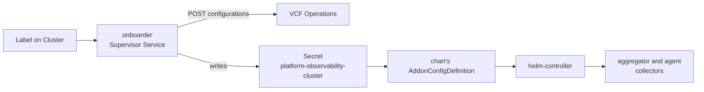

# platform-observability addon

[](https://github.com/warroyo/platform-observability-addon/actions/workflows/onboarder.yaml) [](https://github.com/warroyo/platform-observability-addon/actions/workflows/release.yaml) [](https://github.com/warroyo/platform-observability-addon/releases) [](https://github.com/warroyo/platform-observability-addon/releases)

## Overview

This repo automates onboarding VKS clusters to VCF Operations Platform
Observability. Label a cluster, and it is onboarded: its OAuth client is
created in VCF Operations, its collectors are installed as a VKS helm addon,
and they stay connected. No script runs per cluster.

It is one helm chart and a Supervisor Service, the onboarder.

## How it works



- The onboarder watches Clusters labelled
  `addons.kubernetes.vmware.com/platform-observability=enabled`. For each one
  it gets the cluster's OAuth client from VCF Operations and writes it into the
  Secret `platform-observability-<cluster>` in the cluster's Supervisor
  namespace. It logs in with a restricted Ops account and needs no VSP
  credential.
- The chart is an OCI artifact on GitHub Packages,
  `oci://ghcr.io/warroyo/platform-observability-addon/charts/platform-observability`.
  The service registers it with the VKS addon manager as a helm AddonRepository.
- The chart ships its own AddonConfigDefinition. It reads that Secret and
  renders the credentials into the chart values.
- The service ships one AddonInstall that attaches the addon to labelled
  clusters in every namespace, and helm-controller installs the collectors
  (`aggregator` and `agent`) in the cluster.
- Removing the label or deleting the Cluster offboards it from Ops, behind a
  finalizer.

See [Architecture](docs/architecture.md).

## Quick start

Prerequisites:

- VKS 3.8 or later. The custom AddonConfigDefinition needs it.
- VCF Operations, and its admin password for the first step.
- The restricted Ops account, created in step 1.

1. Create the onboarding account in VCF Operations, once per Ops instance. It
   has one privilege, `extensions.management.usage`. This is the only step that
   needs the Ops admin password.

   ```sh
   VCF_OPS_URL=https://ops.example.com VCF_OPS_ADMIN_PASSWORD=... \
     scripts/ops-account.sh create
   ```

   It writes the new user's password to `~/.config/vcf-ops/onboard.password`.

   If the account already exists, skip this step and use the password in that
   file. Running `create` again needs the admin password. It updates the role
   and leaves the user's password alone.

2. Install the onboarder service on the Supervisor. Download
   `platform-observability-onboarder.yml` from a release tagged
   `onboarder-v<version>` (or build it, see [Development](docs/development.md)). In vCenter, go to Workload Management > Services >
   Add, upload the file, and install it with these values (or do the same
   through the vCenter API, see [Installing](docs/installing.md)):

   - `ops_url`: VCF Operations, e.g. `https://ops.example.com`. Required.
   - `ops_password`: the password from step 1. Required.

   The service registers the addon and ships the AddonInstall itself. The other
   values are in [Configuration](docs/configuration.md).

3. Label each cluster:

   ```sh
   kubectl -n my-namespace label cluster lab1-vks-01 \
     addons.kubernetes.vmware.com/platform-observability=enabled \
     addon.addons.kubernetes.vmware.com/helm-controller=managed
   ```

   The first label turns the addon on. The second installs `helm-controller`,
   which helm addons need.

The onboarder writes the Secret `platform-observability-lab1-vks-01` in
`my-namespace`, and the collectors install.

Check it:

```sh
kubectl -n my-namespace get secret platform-observability-lab1-vks-01
kubectl -n my-namespace get clusteraddon lab1-vks-01-platform-observability
kubectl -n vcf-monitoring get pods    # in the guest cluster
```

The Secret exists within seconds of the label. The ClusterAddon is Ready after
about 40 s, and the collectors are Running after about 45 s: one agent per node
plus 2 aggregators (6 pods on a 4-node cluster). For fuller checks, see
[Verifying an install](docs/installing.md#verifying-an-install). For problems,
see the [FAQ](docs/faq.md).

To onboard one cluster without the onboarder, see
[Manual onboarding](docs/manual-onboarding.md).

## Repo structure

```text
chart/platform-observability/   umbrella chart (published to ghcr.io by CI): namespace, secrets, aggregator and agent
chart/addon-config-definition.yaml   source of the chart's AddonConfigDefinition
install/addonrepository.yaml    AddonRepository and install (OCI) for registering the addon by hand
examples/addoninstall.yaml      AddonInstall for one Supervisor namespace
onboarder/                      the onboarder Supervisor Service (Go)
scripts/onboard.sh              manual onboarding of one cluster
scripts/ops-account.sh          creates the restricted Ops role and user
scripts/embed-acd.sh            embeds the ACD in Chart.yaml
scripts/probe-ingest.sh         sends test OTLP data with one cluster's OAuth client
.github/workflows/              onboarder tests and release, chart release
docs/                           see below
```

- [docs/installing.md](docs/installing.md): installing the service through the UI or the vCenter API, verifying, uninstalling
- [docs/architecture.md](docs/architecture.md): components, the credentials
  Secret, RBAC, ownership, onboarder behaviour, scale
- [docs/configuration.md](docs/configuration.md): onboarder service values
- [docs/upgrading.md](docs/upgrading.md): upgrading the chart and the service
- [docs/development.md](docs/development.md): make targets, releases, pre-release gate
- [docs/vcf-operations-api.md](docs/vcf-operations-api.md): the Ops API, the onboarding account, secret rotation, `--check`
- [docs/manual-onboarding.md](docs/manual-onboarding.md): `onboard.sh` without the onboarder
- [docs/faq.md](docs/faq.md): operational questions and gotchas
- [docs/decisions.md](docs/decisions.md): design decisions and rejected alternatives
